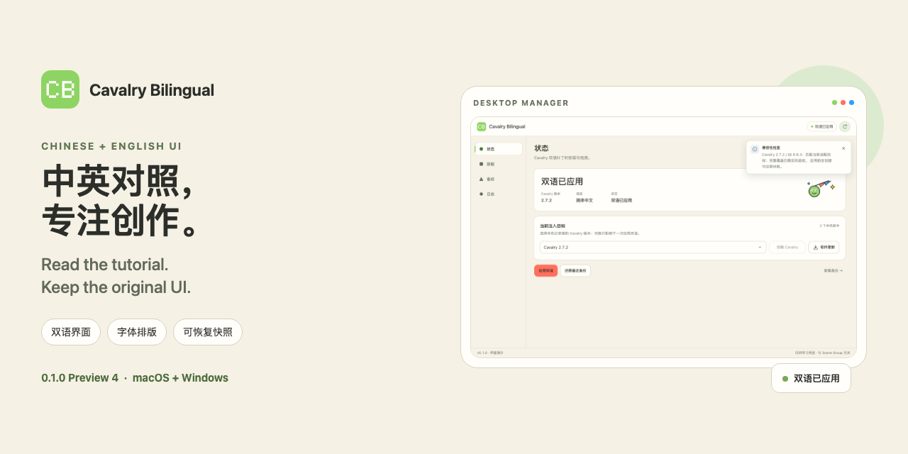

# Cavalry Bilingual



[简体中文](README.md) | **English**

[](https://github.com/luoboruodai/cavalry-chinese-english-software-UI/releases/tag/v0.1.0-preview.4)
[](https://github.com/luoboruodai/cavalry-chinese-english-software-UI/releases/tag/v0.1.0-preview.4)
[](https://github.com/luoboruodai/cavalry-chinese-english-software-UI/releases/tag/v0.1.0-preview.4)
[](LICENSE)

Read Chinese alongside the original English UI, so you can use Cavalry while following English tutorials. The desktop manager also provides typography controls, restorable patches, backups, and user-initiated feedback.

> **Current version: 0.1.0 Preview 4 (pre-release).** Intended for early evaluation and feedback. It is not a stable release and does not establish full-UI, all-version, or all-platform acceptance.
> This project is not affiliated with Scene Group or Cavalry and does not redistribute Cavalry, Qt, or Skia host binaries.

## Download

| Platform | Installer | Current boundary |
|---|---|---|
| macOS arm64 + x86_64 | [Universal DMG](https://github.com/luoboruodai/cavalry-chinese-english-software-UI/releases/download/v0.1.0-preview.4/Cavalry-Bilingual_0.1.0-preview.4_macOS-universal.dmg) | Ad-hoc signed, not notarized; native Intel hardware remains unverified |
| Windows x64 | [NSIS installer](https://github.com/luoboruodai/cavalry-chinese-english-software-UI/releases/download/v0.1.0-preview.4/Cavalry-Bilingual_0.1.0-preview.4_Windows-x64-setup.exe) | Unsigned; cross-built and package-verified, native Windows and real-host acceptance remain incomplete |
| Checksums | [SHA256SUMS.txt](https://github.com/luoboruodai/cavalry-chinese-english-software-UI/releases/download/v0.1.0-preview.4/SHA256SUMS.txt) | Verify the downloaded attachment's SHA-256 |

[Full pre-release notes](docs/RELEASE-0.1.0-preview.4.md) · [Compatibility matrix](docs/COMPATIBILITY.md) · [All releases](https://github.com/luoboruodai/cavalry-chinese-english-software-UI/releases)

GitHub's automatic **Source code** archives are source snapshots, not installers.

## Highlights

- **Chinese + English side by side**: retain the original English while adding Chinese for tutorial-friendly reading.
- **Cavalry 2.7.2 / 2.8.0 on macOS**: version-specific Qt contracts and injection resources stay closed when the target does not match.
- **Typography controls**: adjust language order and fonts with a draft preview; empty font fields follow the system.
- **Restorable patches and backups**: create verified snapshots before changes and preserve the current state before restoring.
- **Clear operation feedback**: status, logs, and supplemental explanations share the same right-side notification language while critical confirmations remain explicit.
- **Windows startup compatibility**: embed the Common Controls v6 manifest to resolve the `TaskDialogIndirect` entry-point startup failure without requesting administrator privileges.
- **User-initiated feedback**: review a redacted report before choosing to send it. No project files, raw Cavalry logs, or automatic telemetry are collected.

## Quick start

1. **Save your project and quit Cavalry yourself.** The tool does not auto-save or force-quit the host.
2. Open Cavalry Bilingual, review the language order and fonts on the Typography page, then save the settings.
3. Refresh detection on the Status page and apply only when the version, resources, and safety contracts match.
4. Relaunch Cavalry. To roll back, choose the corresponding snapshot on the Backups page.
5. If something goes wrong, open “Report a problem” on the Logs page and review the report before choosing to save or send it.

After updating the macOS tool, check **Privacy & Security → App Management** if macOS resets the permission. Re-enable it and restart the tool instead of repeatedly attempting writes after a permission denial.

## Platform status

| Platform / host | Evidence available | Still incomplete |
|---|---|---|
| macOS · Cavalry 2.7.2 / Qt 6.6.3 | Local tool installation, selected real-host and snapshot workflows | Full UI and every project type |
| macOS · Cavalry 2.8.0 / Qt 6.9.2 | Dedicated 2.8 injector/resources, selected UI and viewport text, actual apply/restore workflows | Full UI and general Canvas/Graph/TrackingTool coverage |
| macOS universal | arm64 + x86_64 builds; x86_64 evidence primarily through Rosetta | Native Intel hardware |
| Windows x64 | Cross-built PE/DLLs, synthetic Wine and load checks, NSIS member verification | Native Windows, MSVC, real Cavalry host, and full installation experience |

See [COMPATIBILITY.md](docs/COMPATIBILITY.md) and [NATIVE-ACCEPTANCE.md](docs/NATIVE-ACCEPTANCE.md) for evidence levels. Static ABI checks, synthetic tests, Wine/Rosetta, and native-host validation are not interchangeable.

## Build from source

### macOS Universal

You need Node.js, Python 3.10+, Rust, macOS development tools, the appropriate Qt SDK, and both macOS Rust targets.

```bash
git clone https://github.com/luoboruodai/cavalry-chinese-english-software-UI.git
cd cavalry-chinese-english-software-UI
npm ci --prefix gui/ui
rustup target add aarch64-apple-darwin x86_64-apple-darwin
export CAVALRY_QT_PREFIX=/path/to/Qt/6.6.3/macos
npm run build:macos-universal
```

Output: `gui/target/universal-apple-darwin/release/bundle/macos/Cavalry Bilingual.app`.

For native Windows builds, cross-packaging, and acceptance requirements, see the [Windows/native acceptance guide](docs/NATIVE-ACCEPTANCE.md). Build-time public feedback configuration is documented in [FEEDBACK-SERVICE.md](docs/FEEDBACK-SERVICE.md); mailbox authorization codes and private keys must never be committed.

## Documentation and contributing

- [Project context for agents and maintainers](docs/PROJECT-CONTEXT.md): architecture, original intent, requirement evolution, blockers, and solutions.
- [Design guide](DESIGN.md): visual tokens, layout, motion, focus, and notification principles.
- [Changelog](CHANGELOG.md) · [Preview 3 release notes](docs/RELEASE-0.1.0-preview.4.md)
- [Feedback security](docs/FEEDBACK-SERVICE.md) · [Compatibility matrix](docs/COMPATIBILITY.md)

Remove project files, accounts, real paths, and other private material before filing an issue. Opening the in-app feedback dialog never sends a report by itself.

## License and notices

[MIT](LICENSE). See [NOTICE.md](NOTICE.md) and the bundled `Legal/` directory for upstream and third-party notices.
